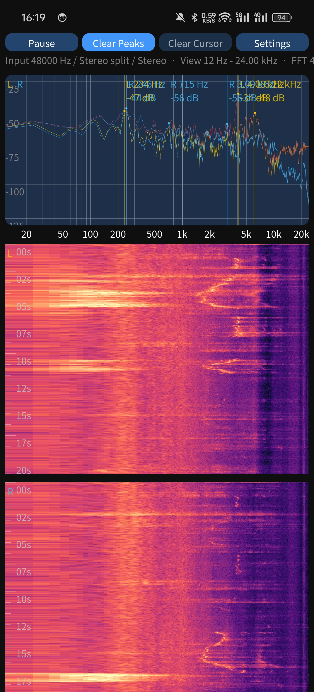
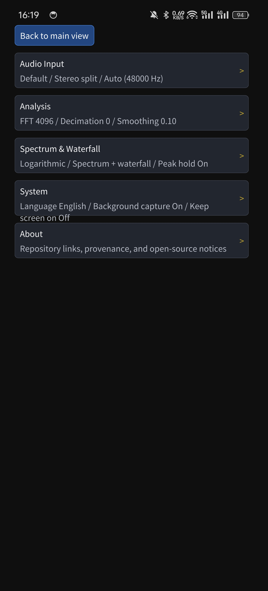

# Spectrogrammer

Real-time audio spectrum analyzer for Android phones, with a Linux build path still available for local development. This repository is an independently maintained Android-first derivative of `aguaviva/Spectrogrammer` (hosted at `https://github.com/Toby7-7/Spectrogrammer`), focusing on multi-rate dual-FFT resolution, universal audio file decoding, stereo baseline comparison, waterfall inspection, background capture, and touch-first controls.

Chinese documentation & guides:
- [README.zh-CN.md](README.zh-CN.md)
- [docs/android-build-install.md](docs/android-build-install.md) / [docs/android-build-install.zh-CN.md](docs/android-build-install.zh-CN.md)
- [docs/fork-differences.md](docs/fork-differences.md) / [docs/fork-differences.zh-CN.md](docs/fork-differences.zh-CN.md)
- [docs/optimization-backlog.zh-CN.md](docs/optimization-backlog.zh-CN.md)

## Features
- **Real-time spectrum & waterfall**: Independent toggles for the upper spectrum and lower waterfall areas, with adjustable waterfall height and row scroll speed (`2 ms`–`250 ms`)
- **Multi-rate dual-FFT stitching (`DualRateFFT`)**: When `Decimation stages >= 1` (`decimationFactor >= 2`), runs both a 31-tap FIR anti-aliased decimated FFT and a temporally centered full-rate FFT, crossfading smoothly with a Hann transition band for crisp low-frequency resolution without sacrificing high-frequency coverage
- **Precomputed analysis windows**: `Rectangular`, `Hann`, `Hamming`, and `Blackman-Harris` lookup tables computed at FFT initialization
- **Frequency-axis scales**: `Linear`, `Logarithmic`, `Music log`, `Mel`, `Bark`, `ERB`
- **Channel modes**: `Mono`, `Left channel`, `Right channel`, `Stereo mix`, `Stereo difference`, `Stereo split` (with L/R display swap)
- **Universal audio file analysis (SAF + NDK MediaCodec)**: Tap `File` to pick audio from anywhere on the phone via Android's System File Picker (`SpectrogrammerActivity`) or from the app's external files directory; supports `.wav`, `.mp3`, `.m4a`, `.aac`, `.flac`, `.ogg`, and `.opus` on Android using the same analysis pipeline, complete with seek bar, pause/resume, and progress display
- **Stereo independent baseline learning**: Press and hold the floating `Hold to Learn Baseline` pill on the spectrum view to capture an averaged reference baseline (independently per L/R channel in `Stereo split` mode)
- **Baseline difference & waterfall differential colormap**: Overlays `(current - baseline)` centered at `0 dB` (`±30 dB` difference range) and switches the waterfall to differential zero-anchored coloring so quiet/matched baseline regions stay neutral instead of saturating hot/cold
- **Waterfall color maps & freeze**: `Magma`, `Hot/cold`, and `Grayscale` color maps, plus `Freeze waterfall` to hold the waterfall image while the spectrum updates live
- **Threshold alarm**: Trigger on spectral peaks above a configurable dBFS threshold within a frequency range, with hysteresis and optional vibration
- **Time-averaged spectrum & input gain**: Optional `0–64`-frame exponential averaging (`0 = Off`), live input level meter (dBFS), and `-24 dB` to `+24 dB` gain
- **Peak hold & markers**: Configurable falloff (`0`–`120 s`), `0 / 1 / 3 / 5` peak markers selectable from `Live` or `Short hold`
- **Cursor & touch zoom**: Tap or drag cursor line for frequency/dB readout (plus baseline diff when comparing), one-tap `Clear Cursor`, and two-finger pinch zoom / horizontal pan
- **PNG export**: Save the spectrum and each visible waterfall to PNG files (`Save Analysis as PNG` under `Tools & Alarms`)
- **Bilingual UI & Android system integration**: English default with Simplified Chinese switch, foreground microphone service (`CaptureForegroundService` with `FOREGROUND_SERVICE_TYPE_MICROPHONE` and custom monochrome notification icon), keep-screen-on, and Android back-button handling

## Quick Start
1. Install the APK (`org.nanoorg.spectrogrammer`) and grant microphone permission.
2. The top toolbar provides `File`, `Pause/Resume`, `Clear Peaks`, `Clear Cursor` (when cursor is active), and `Settings`.
3. Tap `File` -> `[SAF] Browse Phone Audio...` to open `.wav`, `.mp3`, `.m4a`, `.aac`, `.flac`, `.ogg`, or `.opus` files from phone storage, or select files from the app folder.
4. Tap or drag on the spectrum or waterfall to move the manual cursor and inspect the current frequency, dB level, and baseline difference; use a two-finger gesture to zoom or pan horizontally.
5. Press and hold `Hold to Learn Baseline` (top-right of the spectrum plot) to learn a background baseline, then inspect the `±30 dB` difference curve and differential waterfall; tap `Clear Baseline (Diff)` to exit comparison mode.
6. Open `Settings` to access the six categorized pages: `Audio Input`, `FFT & Processing`, `Spectrum & Peaks`, `Waterfall`, `Tools & Alarms`, and `System & About`.

## Settings Overview

### Audio Input
- `Audio source`: Android recording preset (`Default`, `Generic`, `Voice recognition`, `Camcorder`, `Unprocessed`)
- `Channel mode`: `Mono`, `Left channel`, `Right channel`, `Stereo mix`, `Stereo difference`, or `Stereo split`
- `Swap left/right order`: Shown in `Stereo split` mode; swaps the two display panels
- `Input gain`: Display-path gain adjustment from `-24 dB` to `+24 dB`
- `Sample rate`: Automatic or fixed sample rate (subject to device/driver support)

### FFT & Processing
- `FFT size`: `128` to `8192`
- `Decimation stages`: Enable multi-rate dual-FFT resolution enhancement for low frequencies while preserving high-frequency reach
- `Window function`: `Rectangular`, `Hann`, `Hamming`, or `Blackman-Harris`
- `Exponential smoothing`: Larger values produce a steadier trace
- `Time-averaged spectrum`: `0` (`Off`) to `64`-frame exponential average slider

### Spectrum & Peaks
- `Frequency axis scale`: `Linear`, `Logarithmic`, `Music log`, `Mel`, `Bark`, or `ERB`
- `Show upper spectrum`: Toggle the upper spectrum trace area
- `Show peak-hold trace`: Toggle the held peak trace
- `Peak falloff time`: `0` (infinite hold) to `120 s`
- `Peak markers`: `0 / 1 / 3 / 5` markers, sourced from `Live` or `Short hold`
- `Overlay text size` & `Overlay text opacity`: Adjust readability of peak tags, cursor readouts, and channel legends

### Waterfall
- `Show waterfall`: Toggle the lower waterfall area
- `Freeze waterfall`: Hold the waterfall image while the spectrum updates
- `Waterfall color map`: `Magma`, `Hot/cold`, or `Grayscale`
- `Waterfall height`: Fraction of screen occupied by the waterfall
- `Scroll speed`: Row interval from `2 ms` to `250 ms`

### Tools & Alarms
- `Threshold alarm`: Configure `Enable alarm`, dBFS `Threshold`, frequency range (`0` = DC / Nyquist), and optional vibration when triggered
- `Export` (`Save Analysis as PNG`): Export spectrum and visible waterfall images to the external files directory

### System & About
- `Language`: `English` or `简体中文`
- `Background capture`: Continue recording and processing via foreground service while backgrounded
- `Keep screen on`: Prevent display sleep during monitoring
- `About`: Fork summary, GitHub repository URL, and `Open GitHub repository` shortcut

## Default Configuration
- Language: `English`
- Audio source: `Default`
- Channel mode: `Stereo split`
- Input gain: `0 dB`
- Sample rate: `Auto (48 kHz)`
- FFT size: `4096`
- Exponential smoothing: `0.10`
- Peak marker source: `Short hold`
- Peak-hold trace: enabled with a default `4 s` falloff
- Background capture: enabled

## Screenshot



## Build

### Android (Windows PowerShell — NDK & SDK)
```powershell
# Local dev build (auto-generates or uses local my-release-key.keystore)
powershell -ExecutionPolicy Bypass -File .\build_apk.ps1

# Release build (uses gitignored keystore.properties, env vars, or explicit CLI flags)
powershell -ExecutionPolicy Bypass -File .\build_apk.ps1 -Release
```

### Android (Linux / macOS Make)
```bash
make init-submodules
make doctor-android
make BUILD_ANDROID=y
```

Common Make targets:
```bash
make push
make run
make logcat
make clean
```

Notes:
- Package name: `org.nanoorg.spectrogrammer`; `versionCode` is injected automatically from `git rev-list --count HEAD` and `versionName` defaults to `1.1.0`
- Copy [keystore.properties.example](keystore.properties.example) to `keystore.properties` (gitignored) to configure fixed Release signing across builds; see [docs/android-build-install.md](docs/android-build-install.md) for details
- `make doctor-android` verifies SDK, NDK, build-tools, submodules, and required CLI tools
- Target Android API level is `29`

### Linux
```bash
make BUILD_ANDROID=n
```

### Unit tests (host)
```bash
make test
```
Runs `tests/run_tests.cpp` on Linux/macOS. Covers config save/load and v11→v12 migration, config validation, color maps, the PNG writer (structure, CRCs, pixel round-trip), the FIR anti-alias decimator, the WAV file feeder, and the WAV file picker. Requires a host C/C++ toolchain and zlib development headers (`zlib1g-dev` / `brew install zlib`).

## Repository Layout
- `src/app`: spectrum UI, axes, waterfall, configuration, and dual-rate FFT logic
- `src/audio`: OpenSL ES audio capture, NDK `MediaCodec` / WAV file decoding, and Linux ALSA backend
- `src/java/org/nanoorg/spectrogrammer`: `SpectrogrammerActivity` (SAF picker + JNI bridge) and `CaptureForegroundService`
- `src/res`: localized string resources, launcher icon, and monochrome notification vector icon (`ic_notification.xml`)
- `docs`: build/install guides, fork differences summary, and future optimization backlog
- `fastlane/metadata`: store listing metadata and screenshots
- `submodules/imgui`, `submodules/kissfft`: upstream dependencies (HTTPS submodule URLs)

## Notes
- High sample rates and the `Unprocessed` audio source depend on device and driver support; unsupported fixed rates fall back to a lower working rate when possible.
- The alarm vibration uses the `VIBRATE` permission (normal permission, declared in the manifest).
- On Android, audio file analysis supports `.wav` (built-in 16/24/32-bit PCM or 32-bit IEEE float reader) as well as `.mp3`, `.m4a`, `.aac`, `.flac`, `.ogg`, and `.opus` via Android NDK `MediaExtractor`/`MediaCodec`; Linux builds support `.wav`.
- This repository prioritizes Android phone usability; Linux support remains available for local development.

## Recent Highlights (v1.1.0)
- **Multi-rate dual-FFT & window LUT**: Added `DualRateFFT` Hann-crossfade stitching (`decimationFactor > 1`) and precomputed window lookup tables in [src/app/fft.h](src/app/fft.h)
- **Universal Android audio decoding & SAF import**: Added `SpectrogrammerActivity` SAF picker with filename sanitization and Android NDK `MediaCodec` decoding in [src/audio/file_source.cpp](src/audio/file_source.cpp)
- **Stereo independent baseline learning & waterfall differential colormap**: Added floating `Hold to Learn Baseline` button, independent L/R baselines in split mode, and restored differential zero-anchored waterfall coloring
- **Reorganized Settings UI**: Split settings into six touch-friendly pages (`Audio Input`, `FFT & Processing`, `Spectrum & Peaks`, `Waterfall`, `Tools & Alarms`, `System & About`)
- **Package restoration & engineering hygiene**: Restored package `org.nanoorg.spectrogrammer`, added dynamic `versionCode` injection (`git rev-list --count HEAD`), BOM-free manifest generation, custom monochrome notification icon, `FOREGROUND_SERVICE_TYPE_MICROPHONE` API adaptation, standardized Release signing (`keystore.properties`), and zero-warning builds across C/C++ and Java

## Licensing and Provenance
- This repository is derived from `aguaviva/Spectrogrammer` and retains inherited or adapted upstream code.
- No single license applies to every file in this repository; see file headers, bundled component licenses, [LICENSE](LICENSE), and [NOTICE](NOTICE).
- Known origins include Android Open Source Project native audio sample code, `cnlohr/rawdrawandroid`, `Dear ImGui`, `KISS FFT`, and custom code added in this repository.
- Standalone files added in this repository that do not carry inherited upstream code are available under Apache License 2.0; see [NOTICE](NOTICE).

## Acknowledgements
- [aguaviva/Spectrogrammer](https://github.com/aguaviva/Spectrogrammer)
- [cnlohr/rawdrawandroid](https://github.com/cnlohr/rawdrawandroid)
- [mborgerding/kissfft](https://github.com/mborgerding/kissfft)
- [ocornut/imgui](https://github.com/ocornut/imgui)
