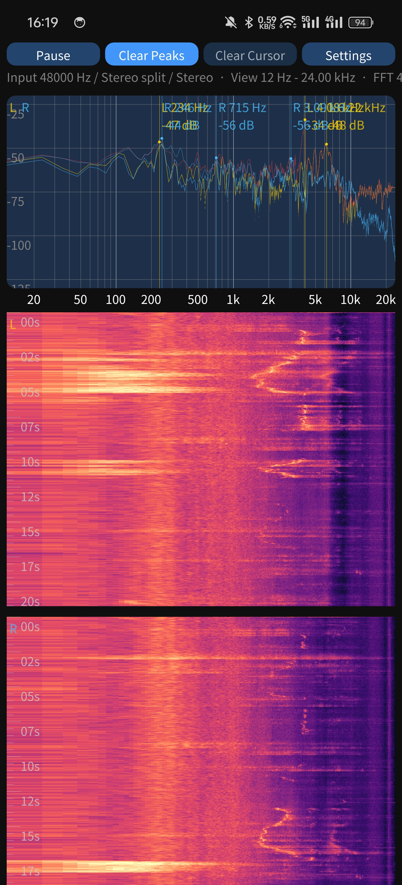
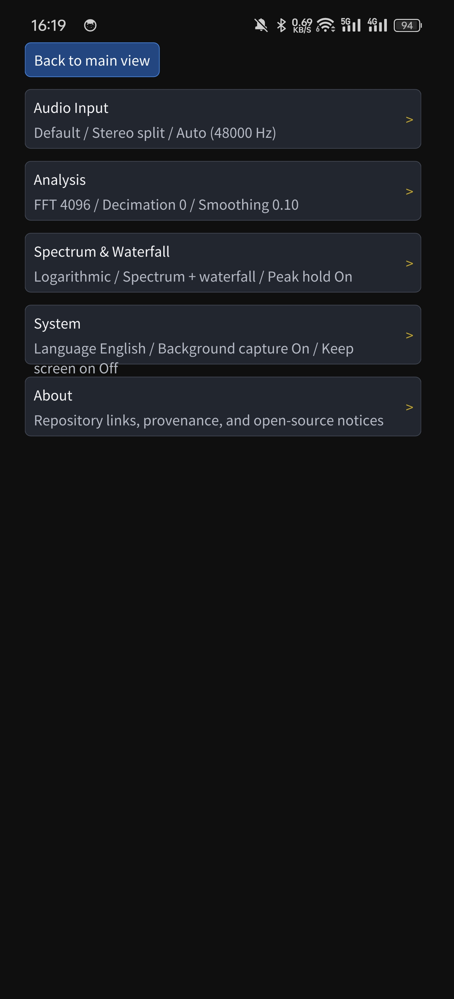

# 频谱仪 / Spectrogrammer

一个面向 Android 手机的实时音频频谱分析器（同时保留 Linux 构建路径用于本地开发）。本项目最早衍生自 `aguaviva/Spectrogrammer`，现作为独立仓库（`https://github.com/Toby7-7/Spectrogrammer`）长期演进，重点增强了多采样率拼接高分辨率 FFT、全格式音频文件解码、双声道独立基线对比、瀑布图分析、后台采集保活以及触控交互体验。

相关文档：
- 英文说明：[README.md](README.md)
- 构建与安装：[docs/android-build-install.zh-CN.md](docs/android-build-install.zh-CN.md) / [docs/android-build-install.md](docs/android-build-install.md)
- 衍生差异说明：[docs/fork-differences.zh-CN.md](docs/fork-differences.zh-CN.md) / [docs/fork-differences.md](docs/fork-differences.md)
- 后续优化清单：[docs/optimization-backlog.zh-CN.md](docs/optimization-backlog.zh-CN.md)

## 主要特性
- **实时频谱与瀑布图**：支持独立开关上方频谱图和下方瀑布图，可调瀑布图高度占比与滚动速度（`2 ms`～`250 ms`）
- **多采样率双路拼接 FFT（`DualRateFFT`）**：当 `抽取级数 >= 1`（`decimationFactor >= 2`）时，同时运行带 31 阶 Hamming 窗 sinc FIR 抗混叠低通滤波的降采样 FFT 与时间居中的全速 FFT，并通过 Hann 过渡带平滑拼接，在兼顾高频范围的同时显著提高低频分辨率
- **预计算窗函数查找表**：FFT 初始化阶段预生成 `矩形窗`（Rectangular）、`汉宁窗`（Hann）、`汉明窗`（Hamming）、`布莱克曼-哈里斯窗`（Blackman-Harris）窗表，避免实时采集循环逐样本重复计算三角函数
- **丰富频率轴刻度**：支持 `线性`、`普通对数`、`音乐对数`、`Mel`、`Bark`、`ERB`
- **多种声道模式**：支持 `单声道`、`左声道`、`右声道`、`双声道混合`、`双声道相减`、`双声道独立`（支持左右显示顺序交换）
- **全格式音频文件分析（SAF + Android NDK MediaCodec）**：点击顶部 `文件` 按钮可通过系统文件选择器（`SpectrogrammerActivity` SAF 导入）直接浏览手机任意目录的音频，或从应用外部文件目录加载；Android 端支持 `.wav`、`.mp3`、`.m4a`、`.aac`、`.flac`、`.ogg`、`.opus`，复用与实时采集一致的完整分析管线，支持拖动进度条（Seek）、暂停/继续、进度与采样率显示
- **双声道独立基线学习**：长按频谱图右上角浮动按钮 `按住学习基线`，可累积平均参考基线（在 `双声道独立` 模式下左右声道分别学习各自独立基线）
- **基线差值曲线与瀑布图差分色阶**：叠加显示 `(当前 - 基线)`（0 dB 居中、`±30 dB` 差值范围），并在基线对比开启时使瀑布图同步切换至围绕 0 dB 零点的差分色阶，让匹配基线的底噪保持中性不饱和
- **瀑布图配色与冻结**：支持 `岩浆` / `热冷` / `灰度` 三种色图，支持 `冻结瀑布图`（瀑布图定格，上方频谱继续实时刷新）
- **频段阈值报警**：支持设定频率范围与 dBFS 阈值，触发时可振动提示，自带迟滞防抖
- **时间平均频谱与增益控制**：支持 `0`（关闭）～`64` 帧指数平均、状态栏实时输入电平（dBFS）以及 `-24 dB`～`+24 dB` 增益调节
- **峰值保持与峰值标记**：回落时间 `0`～`120 s` 可调，`0 / 1 / 3 / 5` 个峰值标记可选来源（`实时峰值` / `短时峰值`）
- **游标与双指缩放**：单指点击或拖动查看频率/dB 读数（开启对比时同步显示基线差值），支持一键 `清除游标` 以及双指横向缩放和平移
- **PNG 导出**：在 `报警与工具` 中点击 `导出当前图表为 PNG`，可将频谱图及可见声道瀑布图导出为 PNG
- **中英文切换与 Android 系统适配**：默认英文，可在 `系统与关于 > 语言` 切换 `简体中文`；配备规范的麦克风前台保活服务（`CaptureForegroundService`、`FOREGROUND_SERVICE_TYPE_MICROPHONE` 与专属单色矢量通知图标）、保持亮屏及返回键手势适配

## 快速上手
1. 安装 APK（包名 `org.nanoorg.spectrogrammer`）并授予录音权限。
2. 主界面顶部工具栏提供 `文件`、`暂停/继续`、`清除峰值`、`清除游标`（游标激活时可用）、`设置` 按钮。
3. 点 `文件` -> `[系统选择器] 浏览手机音频文件...` 可直接打开手机内 `.wav`、`.mp3`、`.m4a`、`.aac`、`.flac`、`.ogg`、`.opus` 文件做离线分析，也可读取应用目录内文件。
4. 在频谱图或瀑布图上单指点击/拖动移动手动游标；双指左右缩放或平移局部频段。
5. 长按频谱图右上角 `按住学习基线` 采集环境基准，随后可叠加观察 `±30 dB` 差值曲线与差分瀑布图；点击 `清除基线 (差值中)` 即可退出对比模式。
6. 打开 `设置` 可进入 6 大分类页面：`音频输入`、`FFT 与平滑`、`频谱与测量`、`瀑布图`、`报警与工具`、`系统与关于`。

## 设置速览

### 音频输入
- `音频源`：Android 录音模式（默认、通用、语音识别、摄像机、未处理）
- `声道模式`：`单声道`、`左声道`、`右声道`、`双声道混合`、`双声道相减`、`双声道独立`
- `交换左右顺序`：在 `双声道独立` 下对调左右面板顺序
- `输入增益`：`-24 dB` 到 `+24 dB`
- `采样率`：自动或固定档位（取决于设备硬件与驱动支持）

### FFT 与平滑
- `FFT 大小`：`128` 到 `8192`
- `抽取级数`：开启多采样率双路拼接 FFT，在保留高频视图的同时显著细化低频分辨率
- `窗函数`：`矩形窗`、`汉宁窗`、`汉明窗`、`布莱克曼-哈里斯窗`
- `指数平滑因子`：数值越大曲线越平滑
- `时间平均频谱`：`0`（`关闭`）到 `64` 帧指数平均滑条

### 频谱与测量
- `频率轴刻度`：`线性`、`普通对数`、`音乐对数`、`Mel`、`Bark`、`ERB`
- `显示上方频谱图`：开关上方频谱图区域
- `显示峰值保持曲线`：显示或隐藏峰值保持曲线
- `峰值回落时长`：`0`（不回落）到 `120 s`
- `峰值标记`：`0 / 1 / 3 / 5` 个峰值点，可选 `实时峰值` 或 `短时峰值`
- `图上标注字号` 与 `图上标注透明度`：调节峰值标签、游标读数及声道说明文字样式

### 瀑布图
- `显示瀑布图`：开关下方瀑布图区域
- `冻结瀑布图`：暂停瀑布图滚动，频谱继续更新
- `瀑布图配色`：`岩浆` / `热冷` / `灰度`
- `瀑布图高度`：设置瀑布图占屏比例
- `滚动速度`：瀑布图行间隔 `2 ms` 到 `250 ms`

### 报警与工具
- `阈值报警`：开关 `启用报警`、配置频段（0 = 直流 / 奈奎斯特）、dBFS 阈值及触发振动
- `分析图表导出`：`导出当前图表为 PNG`，导出频谱与瀑布图到外部文件目录

### 系统与关于
- `语言`：`English` 或 `简体中文`
- `后台采集`：切后台后通过麦克风前台服务持续运行
- `保持亮屏`：监控期间防止自动息屏
- `关于`：仓库简介、GitHub 地址与 `打开 GitHub 仓库` 按钮

## 默认配置
- 语言：`English`
- 音频源：`默认`
- 声道模式：`双声道独立`
- 输入增益：`0 dB`
- 采样率：`自动（48 kHz）`
- FFT 大小：`4096`
- 平滑因子：`0.10`
- 峰值标记来源：`短时峰值`
- 峰值保持曲线：开启，默认 `4 秒` 回落
- 后台采集：开启

## 截图



## 构建

### Android（Windows PowerShell — NDK & SDK）
```powershell
# 本地开发构建（默认使用或生成本地 my-release-key.keystore）
powershell -ExecutionPolicy Bypass -File .\build_apk.ps1

# 正式签名发布构建（读取已被 .gitignore 忽略的 keystore.properties、环境变量或命令行参数）
powershell -ExecutionPolicy Bypass -File .\build_apk.ps1 -Release
```

### Android（Linux / macOS Make）
```bash
make init-submodules
make doctor-android
make BUILD_ANDROID=y
```

常用 Make 命令：
```bash
make push
make run
make logcat
make clean
```

说明：
- 统一主包名为 `org.nanoorg.spectrogrammer`，构建时自动将 `git rev-list --count HEAD` 注入 `versionCode`，`versionName` 默认为 `1.1.0`；
- 正式发版前可复制 [keystore.properties.example](keystore.properties.example) 为 `keystore.properties`（已被 `.gitignore` 忽略）配置固定签名，详见 [docs/android-build-install.zh-CN.md](docs/android-build-install.zh-CN.md)；
- `make doctor-android` 会检查 SDK、NDK、build-tools、子模块及必要命令；
- 当前 Android 目标 API 为 `29`。

### Linux
```bash
make BUILD_ANDROID=n
```

### 单元测试（开发机）
```bash
make test
```
在 Linux/macOS 上运行 `tests/run_tests.cpp`，覆盖配置保存/加载与 v11→v12 迁移、配置校验、色图、PNG 写出（结构、CRC、像素回读）、FIR 抗混叠抽取、WAV 文件源与文件选择器。需要主机 C/C++ 工具链和 zlib 开发头文件（如 `zlib1g-dev` / `brew install zlib`）。

## 目录说明
- `src/app`：频谱 UI、坐标轴、瀑布图、配置及双采样率 FFT 核心逻辑
- `src/audio`：OpenSL ES 音频采集、NDK `MediaCodec` / WAV 解码及 Linux ALSA 后端
- `src/java/org/nanoorg/spectrogrammer`：`SpectrogrammerActivity`（SAF 文件选择与 JNI 桥接）与 `CaptureForegroundService`
- `src/res`：多语言字符串、应用图标与单色矢量通知图标（`ic_notification.xml`）
- `docs`：打包安装说明、衍生差异记录及后续优化规划清单
- `fastlane/metadata`：应用发布元数据与截图
- `submodules/imgui`、`submodules/kissfft`：上游子模块依赖（HTTPS 协议地址）

## 已知注意事项
- 高采样率和 `未处理` 音频源是否可用取决于设备与驱动支持；不支持的固定采样率会尽量自动回退到可用档位。
- 报警振动使用 `VIBRATE` 普通权限（已在 manifest 中声明）。
- Android 端支持 `.wav`（内置 16/24/32-bit PCM 与 32-bit float 解析）及 `.mp3`、`.m4a`、`.aac`、`.flac`、`.ogg`、`.opus`（NDK `MediaExtractor`/`MediaCodec` 硬/软解）；Linux 端支持 `.wav`。
- 本仓库优先保证 Android 手机使用体验，Linux 构建路径仍保留用于开发调试。

## 版本重点更新（v1.1.0）
- **多采样率双路拼接 FFT 与窗表预计算**：在 [src/app/fft.h](src/app/fft.h) 实现降采样 + 全速双 FFT 与 Hann 交叉淡化拼接，并将加窗从逐样本三角函数计算优化为预计算查找表
- **全格式音频解码与系统 SAF 文件选择器**：在 [src/audio/file_source.cpp](src/audio/file_source.cpp) 与 `SpectrogrammerActivity` 接入 Android NDK `MediaCodec` 解码与 SAF 导入（含文件名安全过滤）
- **双声道独立基线学习与瀑布图差分配色**：新增谱图右上角 `按住学习基线` 浮动按钮、左右独立基线学习以及围绕 0 dB 零点的瀑布图差分色阶渲染
- **设置页分类重构**：重组为 `音频输入`、`FFT 与平滑`、`频谱与测量`、`瀑布图`、`报警与工具`、`系统与关于` 六大分类页面
- **工程与规范完善**：恢复主包名 `org.nanoorg.spectrogrammer` 统一覆盖升级，支持动态 `versionCode` 注入、无 BOM Manifest 生成、专属单色通知图标、`FOREGROUND_SERVICE_TYPE_MICROPHONE` 适配、固定 Release 签名规范及全量编译 **0 警告**

## 许可与来源
- 本仓库基于 `aguaviva/Spectrogrammer` 衍生演进，仍包含继承和改写自上游的代码，并非从零重写。
- 当前仓库不对所有继承代码声明单一统一许可证；请以文件头声明、子目录许可证文件、[LICENSE](LICENSE) 和 [NOTICE](NOTICE) 为准。
- 已明确可识别的来源包括 Android Open Source Project 原生音频样例、`cnlohr/rawdrawandroid`、`Dear ImGui`、`KISS FFT` 以及本仓库新增代码。
- 本仓库新增且不含既有上游代码的独立文件按 Apache License 2.0 提供；明确列表见 [NOTICE](NOTICE)。

## 致谢
- [aguaviva/Spectrogrammer](https://github.com/aguaviva/Spectrogrammer)
- [cnlohr/rawdrawandroid](https://github.com/cnlohr/rawdrawandroid)
- [mborgerding/kissfft](https://github.com/mborgerding/kissfft)
- [ocornut/imgui](https://github.com/ocornut/imgui)
